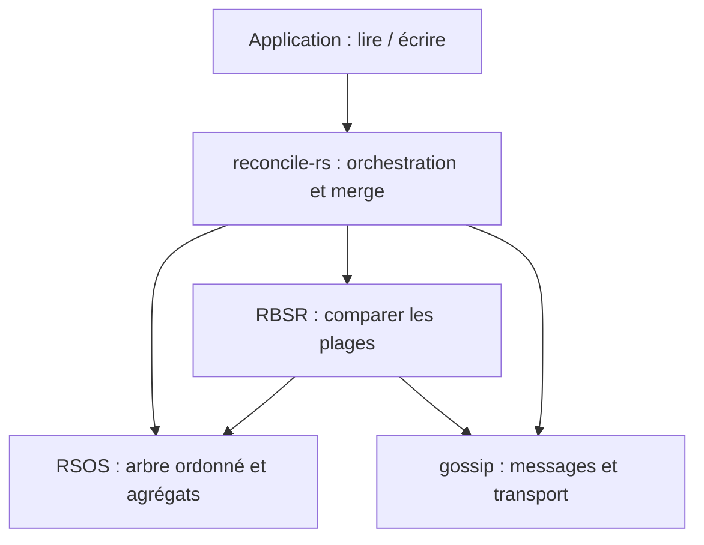

# Présenter reconcile-rs

## Fil conducteur : quatre minutes, une seule vue

Le message à retenir : **chaque instance garde son état local et peut écrire sans coordination ;
le runtime répare les divergences quand les échanges redeviennent possibles.** RSOS fournit le
stockage ordonné et les agrégats utilisés pour comparer les plages. Il est dans chaque réplique.

Garder les notes et l'activité repliées pendant la présentation. Les ouvrir pour une question.
Cliquer après l'explication, puis laisser le public regarder. Si un échange tarde, commenter l'état
observé : ne pas annoncer une convergence avant qu'elle soit affichée.

| Moment | Action à l'écran | Ce que je dis | Où je pointe |
|---|---|---|---|
| 0:00–0:35 | Aucune | « Je voulais que des instances puissent garder et modifier leur état même quand elles ne communiquent plus. Voici trois stores embarqués, sans maître. » | A, B, C ; couche runtime et backend dans chaque case |
| 0:35–1:15 | Write on A | « Le code applicatif écrit sur A. L'écriture locale n'attend pas l'accord des autres. Le runtime leur propage ensuite les entrées datées. » | Les valeurs, puis l'indicateur d'accord |
| 1:15–2:05 | Isolate C + write | « C est isolé. A et C modifient la même clé sans voir l'autre écriture. A et B peuvent se rejoindre ; C garde sa propre valeur. » | alpha sur A/B, charlie sur C ; liens coupés |
| 2:05–2:45 | Aucune | « RSOS organise les entrées et résume des plages par un nombre d'éléments et une empreinte. Ici les plages extérieures sont identiques ; celle contenant la clé modifiée diffère. » | Une seule ligne différente dans la table des plages |
| 2:45–3:30 | Reconnect C | « Je rétablis les liens, sans réécrire les données. Le protocole compare et échange du contenu. Le merge LWW retient le plus grand stamp. » | Stamp de m/status, puis accord exact des entrées |
| 3:30–4:00 | Aucune | « La valeur perdante est écrasée. La bibliothèque assure cette convergence ; le métier doit choisir si cette règle convient. Cette démo n'est ni un consensus ni un benchmark. » | Les trois copies locales finales |

Les durées sont un budget de parole, pas des échéances du protocole. Une fois la convergence
observée, les compteurs peuvent continuer à augmenter : le runtime poursuit ses échanges périodiques.

## Approfondissement : deux minutes si demandé

La vue montre des états réellement produits par le système, pas une animation du comportement attendu.
Les empreintes abrégées sont une aide visuelle ; la comparaison d'accord utilise les entrées datées
complètes. Les plages affichées sont des requêtes d'inspection fixes, pas les divisions réellement
choisies par RBSR pendant un échange. Ne pas dire « voilà le paquet envoyé » en pointant une cellule.

Ce schéma décrit les responsabilités fonctionnelles, pas un graphe littéral des dépendances Rust.
L'ensemble est embarqué dans chaque instance. Le backend RSOS n'est pas un quatrième participant.

Dire : « L'arbre est persistant, avec partage structurel, et les lectures s'appuient sur des racines
immuables publiées par ArcSwap. » Relier cette propriété au besoin de lectures concurrentes.
Préciser que la démo ne mesure pas les allocations, la contention ou les gains de partage structurel.

## Pistes de discussion

| Question | Point à développer | Limite à reconnaître |
|---|---|---|
| Pourquoi pas simplement diffuser chaque écriture ? | Diffusion rapide plus réparation anti-entropie après pertes ou déconnexion | Cette vue ne compare pas les coûts de différentes stratégies |
| Pourquoi des résumés de plages ? | Comparer du contenu ordonné avant d'énumérer les différences | Trois clés ne démontrent pas un gain de bande passante à grande échelle |
| Pourquoi HLC + LWW ? | Ordre total déterministe avec identité du writer ; traitement des observations distantes | Cela ne détermine pas quelle valeur est correcte pour le métier |
| Et si deux instances prennent la même tâche ? | La convergence d'un store ne fournit pas d'exclusion mutuelle | Il faut une politique applicative ou un mécanisme de coordination adapté |
| Et les suppressions ? | Tombstones, acquittements et stabilité causale pour le GC | La démo principale n'exerce pas le GC |
| Et après un crash ? | Persistance optionnelle et restauration avant de rejoindre le protocole | Ces répliques sont en mémoire |
| Et un réseau réel ? | Port de transport, framing, authentification, réparation | Ici le transport est en mémoire, dans un worker ou un processus |

## Relier à une application

Finir, si pertinent, par un seul exemple verbal : « Une observation découverte par un agent peut
rester disponible localement pendant une coupure, puis être partagée à la reconnexion. Une décision
métier peut alors changer. » L'application motive le mécanisme ; elle n'ajoute aucun écran à la démo.

Pour un entretien, partir du problème et du compromis avant les noms de crates. Adapter la profondeur
aux questions. Ne pas réciter l'inventaire des fonctionnalités : utiliser chaque question pour
expliquer un choix, son coût et ce que le système ne garantit pas.
